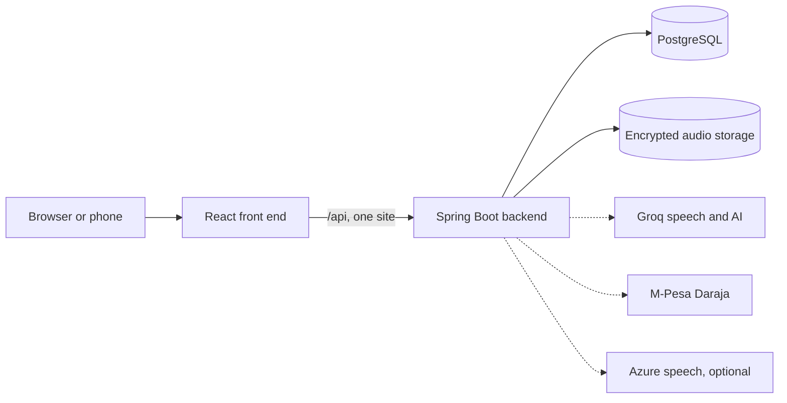

# Sauti HMS

[](https://github.com/hezronokwach/sauti/actions/workflows/ci.yml)

A voice-first hospital management system for Kenyan clinics: reception, triage, consultation with live Swahili and English transcription, prescriptions with allergy checks, and cash or M-Pesa payments.

## Repository layout

| Folder | Contents |
| --- | --- |
| `backend/` | Spring Boot 4.1 application (Java 21, Maven), with `compose.yaml` for local services |
| `frontend/` | React + TypeScript app |
| `eval/` | Speech evaluation |
| `docs/` | Implementation plan and decision log |

## Running the backend locally

Requires JDK 21 and Docker.

```bash
cd backend
./mvnw spring-boot:run
```

Spring Boot starts the containers in `compose.yaml` automatically. Tests use Testcontainers:

```bash
./mvnw verify
```

## Running the frontend

Requires Node 26. With the backend running:

```bash
cd frontend
npm install
npm run dev
```

Open http://localhost:5173; the page shows whether the backend answers through the dev proxy. See `frontend/README.md` for the checks (lint, type-check, format, tests).

## Code quality checks

`./mvnw verify` (locally and in CI) also fails when:

- code is not formatted with palantir-java-format (Spotless); fix it with `./mvnw spotless:apply`
- the compiler reports a warning (`-Xlint:all -Werror`)
- Error Prone finds a likely bug; the message names the pattern and a suggested fix

It also writes a test coverage report to `backend/target/site/jacoco/index.html`; CI uploads it as the `backend-coverage` artifact.

## Configuration

Every environment variable is listed by name in `.env.example`. Never commit real values.

## Architecture



Dotted lines are outside services. Development and tests use fakes for all of them.

## Demo

The demo link will be added here after deployment. Follow [the ten-minute script](docs/demo-script.md). All demo patients are made up.

## Evaluation and known weak spots

**No speech accuracy results exist yet.** The evaluation needs real voice recordings, which have not been collected.

- AI checks catch unsupported claims but not every wrong meaning, so a clinician must read each summary.
- The recorder has not been tested with a real microphone across devices.
- Swahili wording needs review by a fluent speaker.
- The medicine list and safety rules have not been clinically reviewed. There are no drug interaction checks.
- This is not ready for real patients. Hosting in Kenya, data agreements, ODPC registration, a data protection impact assessment, a penetration test and certification all come first.

## Testing with real speech locally

Local runs use a fake transcriber that shows the same made-up lines for every recording. To use real speech, add these to the git-ignored `.env` beside `GROQ_API_KEY`, then restart the backend:

```
TRANSCRIPTION_PROVIDER=groq
AI_PROVIDER=groq
```

Recorded audio and transcripts are then sent to Groq. Use only your own voice, never a real patient's. The backend log says which transcriber is active.
